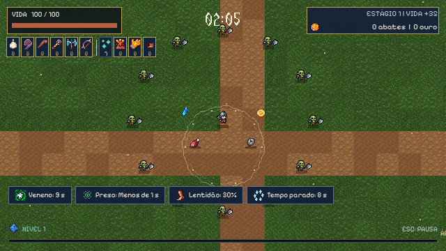
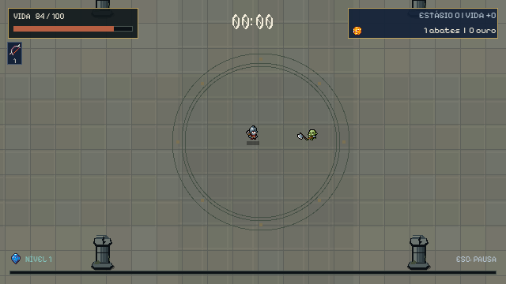

# Ajustes PC 0.21.0

Base: PC 0.20.0, commit `9f4982d`, cujo código de gameplay é `4b6e2e5dd1a86c2feb8ed169c8da305c0fd5d0a8`. Trabalho exclusivo no PC. Nenhuma edição, sincronização, execução, teste ou exportação Android nesta etapa. Protocolo de transporte 2 preservado; versão de gameplay 0.21.0. O relay recusa mistura com PC/Android 0.20.0.

## Implementado

### Flechas

Cada flecha mira da própria origem, na altura do arco. Disparos adicionais distribuem os alvos válidos; quando há menos alvos, convergem para os disponíveis em vez de abrir um leque que passa ao lado do único inimigo. Não há perseguição após o lançamento. Referências mortas são descartadas.

A seleção mantém os alcances anteriores: 240, 255, 260, 290, 310, 347,2, 347,2 e 388,86 pixels. O voo recebe uma margem configurável de 32 pixels, separada do alcance de seleção, para cobrir o deslocamento da origem. Dano, quantidade, velocidade de 275 pixels/s antes dos bônus e regras de perfuração/ricochete foram preservados. A descrição distingue seleção e voo.

O segmento é limitado pela distância restante. O contato considera o deslocamento da flecha e do inimigo no mesmo passo, resolve o primeiro instante de colisão e respeita parede antes de alvo. A consulta usa a grade espacial, ampliada pelo deslocamento real do inimigo, sem percorrer toda a horda para cada flecha. Acertos já registrados não se repetem. O reaparecimento do Shadow reinicia a origem da varredura, para não tratá-lo como corpo atravessando o caminho invisível de um teletransporte.

### Proporções e morte do Orc

O importador mantém o mesmo recorte fixo e os mesmos pivôs, mas retira a ampliação de 2×. Cada pixel original ocupa um pixel lógico, com nearest.

| Elemento | Antes | Depois |
| --- | --- | --- |
| Célula do atlas | 112×80 | 56×40 |
| Altura visível na primeira espera do Soldado | 36 px | 18 px |
| Altura visível na primeira espera do Orc | 30 px | 15 px |
| Offset do Soldado | (0, -24) | (0, -12) |
| Offset do Orc, virado à direita | (-4, -18) | (-2, -9) |
| Colisão física | Jogador 7 px, Orc 8 px | Mantida após revisão do corpo, sem usar margens ou armas |

Nomes e barras foram aproximados dos corpos menores. Sombras já correspondiam aos raios físicos e foram preservadas. Não foi escalado o nó de movimento ou o sistema de armas; velocidade e alcance não mudaram por causa do visual.

A morte espelhada deslocava a origem do retângulo ao usar largura negativa. Agora o desenho espelha as coordenadas locais em torno do mesmo pivô do Sprite2D vivo. O evento continua usando posição física, quadro e identidade oficiais. Oito comparações de imagem, quatro instantes em cada orientação, ficaram idênticas ao quadro correspondente do Sprite2D. Quarenta mortes consecutivas, duplicação de evento e limpeza no reinício também foram verificadas. Não foi encontrado pool de inimigos nessa implementação: há criação e descarte de instâncias; o teste não é apresentado como validação de um pool inexistente.

### Runa Traçante

Escolhe aleatoriamente entre inimigos vivos dentro dos 300 pixels de seleção. Sem alvo, sorteia direção. Não persegue após disparar. O retângulo lógico 640×360 é recalculado a partir do dono, com o mesmo limite da câmera da arena, durante a vida de cada runa. Não depende da janela física do cliente.

Quando a câmera deixa uma runa fora do retângulo, ela pode retornar sem mudança instantânea de posição. Cada eixo da borda só pode inverter uma vez no passo; o percurso ainda considera os obstáculos. Duração, dano, perfuração e intervalo por alvo de meio segundo foram mantidos. Clientes antecipam somente o desenho da trajetória, sem calcular dano. O host continua oficial.

### Alho

Somente o raio-base recebeu 15%, antes dos bônus de área:

| Nível | Antes | Depois |
| --- | ---: | ---: |
| 1 | 28 | 32,2 |
| 2 | 38 | 43,7 |
| 3 | 38 | 43,7 |
| 4 | 43 | 49,45 |
| 5 | 43 | 49,45 |
| 6 | 49 | 56,35 |
| 7 | 49 | 56,35 |
| 8 | 55 | 63,25 |

Com Lupa 8 e Área permanente máxima, o raio chegou a aproximadamente 99 pixels. Visual e detecção consultam o mesmo valor. Dano, lentidão de 15%, empurrão inicial e intervalo por alvo foram preservados.

### Variantes com armadura

Configuração central: `data/variants21.json`. São substituições dentro da composição, sem aumentar a quantidade total e sem reutilizar o multiplicador de elite antigo.

| Variante | Início | Fração da classe-base | Redução de dano |
| --- | --- | --- | --- |
| Orc com armadura | 4 min | 10% dos Orcs | 5% |
| Orc de elite | 8 min | 5% dos Orcs | 15% |
| Esqueleto com armadura | 6 min | 10% dos esqueletos de espada | 10% |

Depois dos oito minutos, 85% da parcela de Orcs continua comum, 10% com armadura e 5% elite. Vida, velocidade, dano e recompensas derivam da classe-base com os modificadores existentes aplicados uma vez. A redução é própria da variante, não resistência automática por tempo. O sistema temporal continua sem adicionar resistência.

**A mecânica está implementada, mas o visual Tiny RPG destas variantes está pendente.** Elas mantêm o corpo anterior da classe e recebem um pequeno ícone de armadura acima dele. Isso permite identificar a variante sem fingir que as spritesheets pedidas foram obtidas. No DEV, F8, aba Desempenho, há botões para gerá-las. O perfil continua temporário e apenas o host pode usar os controles.

### Interface e identificação

Milissegundos não aparecem na interface normal. Tempos inteiros usam segundos; tempos fracionários maiores que um segundo são explicitamente aproximados. Intervalos menores usam Ataques rápidos ou frequência inteira quando exata. Exemplo: meio segundo vira 2 ataques por segundo; 400 milissegundos vira Ataques rápidos nas descrições de intervalo. Status breves usam Menos de 1 s. Comparações que resultam no mesmo texto mostram a diferença percentual. A precisão dos cálculos permanece intacta. Logs e painel técnico DEV podem usar unidades técnicas.

Coroa passou a Toque do Midas. O ID `crown`, os oito níveis e os 7% aditivos de experiência por nível continuam iguais, chegando a 56%. Não concede bônus de ouro. A coleção atual é de itens e consumíveis; não existe bestiário separado a atualizar.

O arco azul sob o personagem vivo era um marcador de identificação do jogador. Seu desenho foi removido, preservando nomes, sombras, colisões e o marcador do aliado caído usado na reanimação.

## Arquivos visuais pendentes

Foi encontrado apenas `Tiny RPG Character Asset Pack 01 v2.0 -Free Soldier&Orc`, também em ZIP. Não foi localizado `Tiny RPG Character Asset Pack 01 v2.0 -Full 22 Characters.zip`, ou folhas originais equivalentes. [Origem oficial, Zerie](https://zerie.itch.io/tiny-rpg-character-asset-pack). O histórico já limitava a compra aos gratuitos, portanto não foi feita nova compra.

As nove substituições ainda pendentes são Morcego, Necromante e sua conjuração, Esqueleto comum, Esqueleto arqueiro, Esqueleto com armadura, Slime, Orc com armadura, Orc de elite e Orc montado. Os GIFs enviados foram usados para identificar o pedido; não entraram no executável como sprites. Não foi extraída uma imagem de espera para alegar integração de uma animação completa.

Como consequência, o inimigo `hound` ainda mantém o nome e arte anteriores, e a Besta ainda não foi substituída nem renomeada para Orc montado. As divisões, cores e recompensas dos slimes e o Necromante existente foram preservados. Não há alegação de que os novos visuais ou sincronização da nova conjuração tenham sido concluídos.

**Água Benta: novo design pendente.** Os pacotes Raven Fantasy Icons e UIBundleFree não contêm uma sequência de poça com continuidade adequada para essa substituição. A busca de referências no Pinterest não produziu uma opção verificada para incorporar. Foi localizado o estudo [Water Sprites, ludaosmo-16x16](https://www.deviantart.com/ludaosmo-16x16/art/Water-Sprites-501220099), mas sem licença de incorporação verificada nesta etapa; não foi baixado para o jogo. Nenhum efeito genérico novo foi colocado para disfarçar a pendência. Frasco, impacto e poça atuais continuam intactos, incluindo o diâmetro reduzido, dano, duração e não acumulação.

## Testes e limites

Evidências em `docs/refinement21/`. Vinte e uma suítes locais passaram. Cobrem arco e varredura, Runa e câmera móvel, raio e controle do Alho, resistências e 50 mil sorteios de composição, nomes/formatação, limites de build, migração de save, gasto histórico/reembolso, aprimoramentos, rede, consultas espaciais, Devorador, slimes, Água Benta, animações e layouts nos três mapas. Os testes antigos que ainda esperavam preços anteriores, milissegundos ou dois inimigos sobrepostos na borda de uma poça tiveram suas fixtures corrigidas, sem modificar o gameplay para fazê-los passar.

Também passaram os testes de inicialização dos executáveis público e DEV. O executável público não carrega painel DEV. A política e o formato do save foram preservados. O PC 0.20.0 anterior ficou intacto e disponível para comparação.

Quatro processos separados usando o PCK público 0.21.0 atravessaram o relay WSS publicado, com um cliente renderizado e recursos locais isolados dos arquivos do projeto. Os três mapas, as variantes replicadas, seis armas por jogador, a câmera lógica de cada dono e o evento real de morte do Orc na posição física do host passaram. O teste encontrou e corrigiu ausência dos níveis e passivas das builds remotas no desenho das auras. O estado agora vem do host; o cliente não faz uma segunda aplicação de dano ou resistência.

Isso não equivale a quatro máquinas em redes diferentes, nem a uma sessão de trinta minutos. Não houve avaliação humana de diversão ou dificuldade. Os novos sprites e a Água Benta pendentes também impedem considerar toda a direção visual solicitada concluída.

## Desempenho

Comparação no mesmo Windows/Ryzen 5 5600/Radeon RX 6600, renderer Compatibility, janela 1280×720 e viewport 640×360, sem alterar a quantidade das fixtures. Outros aplicativos do usuário foram preservados. Resultados numéricos, método e hashes estão nos JSONs de evidência. As medições com o runtime do editor sobre o PCK e com o executável release nativo são identificadas separadamente. Não usar valores de memória iguais a zero do Godot release como se fossem consumo real.

As execuções curtas têm variação e não provam estabilidade de uma partida longa. Os picos mais pesados continuam acima de 16,7 ms. A comparação dos novos comportamentos apresentou maior custo de simulação em parte dos cenários, mas não isola o custo de cada mudança. Não houve compensação removendo entidades ou acertos. A tabela final acompanha os relatórios anexos.

### Executável release nativo

Fixture legada de diagnóstico: semente 140031, seis cenários, quatro atores simulados, dois segundos de aquecimento e dez segundos de coleta por cenário, limite de 120 FPS. A carga inclui até 225 inimigos comuns, 120 poças, chefes, invocações, cerco, divisão e estado de infinito. As seis armas dessa fixture são Lodo, Água Benta, Lança Relógio, Raio, Bombas e Orbes. Não é apresentada como uma medição específica da Runa/Arco/Alho.

| Cenário | Mediana antes/depois | p95 antes/depois | p99 antes/depois |
| --- | --- | --- | --- |
| Inicial da fixture | 7,27 / 9,26 ms | 10,40 / 10,29 ms | 10,81 / 10,63 ms |
| Quatro builds | 11,76 / 12,51 ms | 20,40 / 21,65 ms | 24,61 / 43,69 ms |
| Chefe e necromantes | 15,94 / 16,98 ms | 60,91 / 49,57 ms | 123,75 / 80,39 ms |
| Divisão de slimes | 13,35 / 13,50 ms | 24,27 / 23,37 ms | 35,37 / 36,83 ms |
| Cerco | 8,33 / 9,49 ms | 11,13 / 10,96 ms | 11,62 / 11,50 ms |
| Estado aos 30 min | 14,35 / 13,40 ms | 33,77 / 27,57 ms | 51,88 / 39,84 ms |

O relógio foi colocado aos trinta minutos na última fixture; não houve uma sessão de trinta minutos. Pico de working set Windows na versão nova: cerca de 215 MiB, com amostragem em 20 Hz. A medição release legada emitiu avisos de objetos/recursos retidos ao encerrar nas duas versões. Eles estão registrados como limitação da ferramenta e não foram usados para afirmar ausência de vazamento na partida. Não há ganho geral comprovado: alguns cenários melhoraram e outros pioraram.

### Arco, Runa e Alho, fixture externa

Uma segunda comparação usa exatamente a mesma fixture externa contra os PCKs entregues, com o runtime do editor e diretório de recursos vazio para impedir que arquivos locais vazem para a medição. Não são FPS do executável release nativo. Semente 21007, 150 inimigos mantidos vivos, quatro atores, seis armas no nível 8 e quatro passivas no nível 8 por jogador. Armas: Arco, Runa, Alho, Água Benta, Lança Relógio e Raio. Aquecimento de dois segundos e coleta de dez segundos em cada mapa, limite de 60 FPS. Os dois PCKs passaram sem erros nesse ambiente isolado.

| Mapa | Mediana antes/depois | p95 antes/depois | p99 antes/depois | Simulação mediana antes/depois |
| --- | --- | --- | --- | --- |
| Pátio | 16,67 / 16,67 ms | 16,74 / 16,73 ms | 16,88 / 16,87 ms | 8,01 / 8,42 ms |
| Biblioteca | 16,67 / 16,67 ms | 16,73 / 16,73 ms | 16,76 / 17,49 ms | 7,76 / 8,32 ms |
| Campos | 16,67 / 16,67 ms | 16,72 / 16,73 ms | 16,75 / 18,02 ms | 7,71 / 8,64 ms |

Os dois mantiveram média próxima de 60 FPS nesse cenário, com maior custo de simulação e alguns picos adicionais na versão nova. Os relatórios registram nós, chamadas de desenho, poças, projéteis e working set do processo real, sem medir por engano o wrapper de console. Estes resultados não garantem 60 FPS com quatro máquinas, rede instável ou carga maior.

## Como testar

Público: `build/Hordas-0.21.0/Hordas-0.21.0.exe`. DEV: `build/Hordas-DEV-0.21.0/Hordas-DEV-0.21.0.exe`, F8. `Jogar.cmd` e os atalhos de chefes apontam para 0.21.0. Todos na sala precisam usar a mesma versão pública ou a mesma versão DEV.

Validação local: `python tools/validate_refinement21.py`. Quatro processos: `node relay/match-test.mjs --packed=build/Hordas-0.21.0/Hordas-0.21.0.exe --harness=tests/refinement_network21.gd --render-one --relay-url=wss://hordas-relay.onrender.com`. Comparação renderizada dos PCKs: `python tools/benchmark21.py`. Nenhum desses comandos chama Android.

## Capturas

