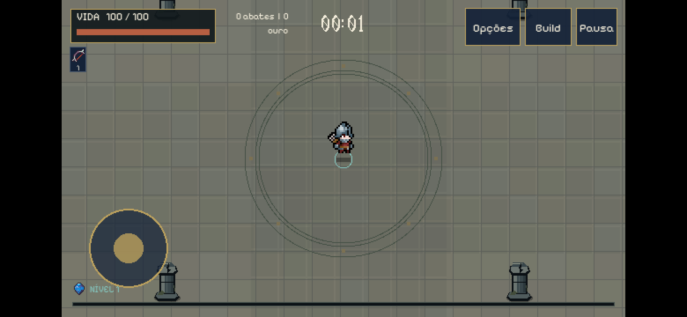
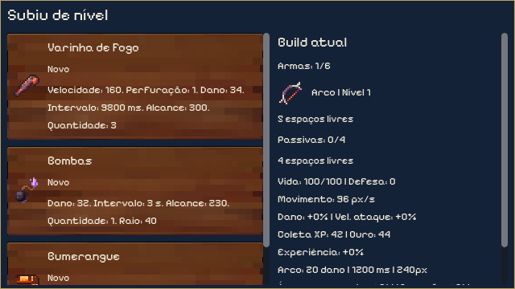
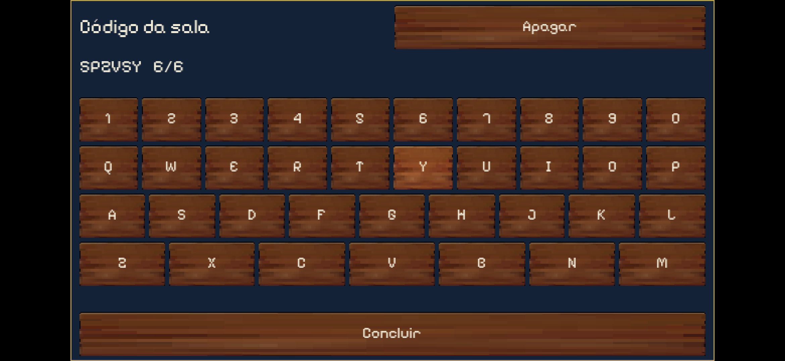
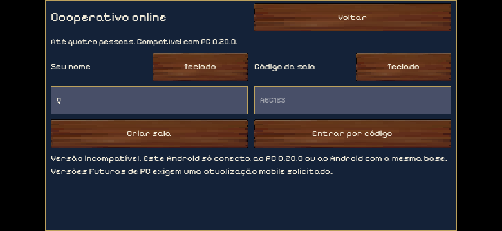

# Hordas Android 0.20.0-android.1

Primeira entrega Android de teste, em 7 de novembro de 2026. O mobile fica congelado após esta entrega. Só voltar a editar, testar, compilar, sincronizar ou publicar quando Arthur mencionar explicitamente celular, Android ou versão mobile. Não integrar Android aos comandos ou releases padrão do PC.

## Base e isolamento

- Código de PC: versão 0.20.0, commit `4b6e2e5dd1a86c2feb8ed169c8da305c0fd5d0a8`.
- Commit seguinte, somente política e documentação no PC: `9f4982d`.
- Branch Android: `codex/android-mobile`. Worktree separado em `C:/Users/Arthur/Documents/Projetos/Hordas Android`.
- A implementação Android não foi mesclada à branch principal. O executável de PC foi preservado.
- Versão Android: `0.20.0-android.1`, versionCode 1, protocolo 2, compatibilidade declarada e testada com PC público 0.20.0. A igualdade de protocolo sozinha não basta: a versão de gameplay também precisa coincidir.

## Instalar e jogar

Copie `Hordas-Android-0.20.0-1.apk` para o aparelho e abra. Autorize a instalação por esse aplicativo quando solicitado. Não é necessário instalar Godot. Requisitos declarados pelo APK: Android 7/API 24 ou superior e OpenGL ES 3. Inclui ARMv7, ARM64 e x86_64. Target SDK 36. Nenhuma loja foi utilizada.

Orientação horizontal. Joystick no canto inferior esquerdo, ataques automáticos. Pausa, Build e Opções no canto superior direito. Interagir aparece perto de baús. Segure: ajudar reanima um aliado; a reanimação tem prioridade quando há baú próximo. Reviver aparece se o benefício individual estiver disponível. Melhorias, compras, confirmação de reembolso, mapas, coleção e resultados usam botões por toque e listas roláveis.

Online: informe nome de até oito caracteres, crie uma sala ou digite o código de seis caracteres. Todos marcam Estou pronto; o anfitrião escolhe mapa e inicia. Não é necessário configurar portas. O serviço gratuito pode levar tempo para despertar. A saída do anfitrião encerra a sala, conforme o PC atual.

Os campos aceitam teclado virtual do sistema. Foi acrescentado o botão Teclado com teclado interno por toque, acentos, apagar e limite de caracteres, porque o IME do emulador Android 15 não abriu de modo confiável. O teclado interno foi validado no APK; o comportamento do IME em aparelho físico continua pendente. Referência do problema do emulador: [Godot issue 87052](https://github.com/godotengine/godot/issues/87052).

## Interface e regras preservadas

A viewport lógica permanece 640×360. Em telas alongadas há barras laterais, preservando o enquadramento de combate, regras de surgimento e limites de ricochete da versão de PC. Os controles e painéis respeitam a área segura. Não foi ampliada a região de combate apenas para preencher a tela. Containers e rolagem substituem os layouts de mouse. Fonte funcional legível; fonte gótica permanece exclusivamente no cronômetro.

Não foram alterados atributos, quantidade de inimigos, danos, intervalos de ataques, recompensas, eventos, chefes, limites de seis armas/quatro passivas ou níveis 1 a 8. Dados de gameplay e IDs permanecem os da base. A compatibilidade online usa a simulação autoritativa e a replicação existentes.

## Ciclo e progresso

Pacote público: `com.socialy.hordas.android`. Save no armazenamento privado do Android; não acessa nem sobrescreve o perfil de PC. A prévia desktop usa a pasta separada Hordas Android. Não há permissão de armazenamento externo nem backup em nuvem habilitado pelo APK.

No solo, sair do aplicativo pausa e solta todos os dedos. Ao voltar, é necessário continuar explicitamente. No online, colocar o aplicativo em segundo plano desconecta esse participante. Se for o anfitrião, a sala termina; se for cliente, os demais continuam. Não há migração de host nem reconexão automática. A perda breve de foco limpa movimento e ações, sem pausar a sessão dos outros. Voltar fecha teclado, retorna dos painéis ou pausa; no menu inicial pede confirmação para fechar.

A atualização por instalação por cima preservou o arquivo de perfil byte por byte no emulador. O progresso permanente é salvo, mas esta entrega não implementa restauração de uma partida em andamento após o Android encerrar o processo. Desinstalar pode apagar o perfil. Evite desinstalar ao atualizar.

## Ajustes gráficos próprios

- Detalhes decorativos padrão: 35%; tremor desligado; limite de 60 FPS.
- Até quatro efeitos sonoros simultâneos, com um canal reservado para avisos relevantes.
- Números de dano: teto 12; no padrão de 35%, até sete.
- Rastros decorativos das runas: dois dos cinco pontos no padrão de 35%.
- Até 24 animações simultâneas de corpos mortos. Corpos vivos, colisões, mortes e recompensas continuam sendo processados.
- Texturas e animações compartilhadas do projeto, filtro nearest e renderer Compatibility. Nenhuma textura é carregada por ataque.

Os limites acima são cosméticos. Reduzir os detalhes nas opções não reduz a horda ou o número de acertos. Instrumentação local registra tempo real entre frames; não usa delta limitado da simulação para mascarar travamentos. Memória release foi medida com `adb dumpsys meminfo`, porque `OS.get_static_memory_usage()` retornou zero nesse ambiente.

## Ambiente e testes

Godot 4.7.2 release, AVD Pixel 5, Android 15/API 35 Google APIs x86_64, dois vCPUs, 2 GiB de RAM. Host Windows, Ryzen 5 5600 e Radeon RX 6600, WHPX e GPU host. Tela Android 2340×1080 horizontal, conteúdo 1920×1080 com barras, renderização interna 640×360. Janela emulada renderizada e capturada via ADB, sem áudio do emulador. Nenhum aparelho físico esteve disponível.

Testes de fonte e layout executaram 28 combinações de telas e área segura. Testes de entrada enviaram eventos reais ao Viewport e verificaram dois dedos, cancelamento, soltura, joystick e botão sem clique no painel que aparece por baixo. Testes de ciclo verificaram pausa do relógio solo, soltura de movimento, saída de lobby, retorno e isolamento do perfil. O teclado foi testado com acentos e limites de nome/código. Compra real pelo botão da grade consumiu o custo correto no perfil isolado. Contratos da base de PC, conteúdo e sobrevivência também passaram na branch Android.

No APK público instalado: abertura em paisagem, mapas, partida, vida legível, movimento por toque, pausa por toque, Voltar, Home/retomada, teclado interno com oito caracteres e atualização sem mudar o save. Inspeção do ZIP e manifesto confirmou assinatura release, pacote, permissões, arquiteturas e ausência de scripts DEV e do executor QA.

O APK público também criou sala no relay e recusou uma sala de teste que anunciava gameplay 0.21.0, mostrando a mensagem de incompatibilidade. Nome e código foram digitados usando somente as teclas internas por toque. O número 0.21.0 foi anunciado por um cliente de protocolo de teste; isso não representa uma versão futura do jogo já implementada.

Cooperativo executado pelo relay público WSS: um host e dois clientes Windows usando o executável público congelado 0.20.0, mais um cliente Android real emulado em processo separado. Quatro jogadores, 80 inimigos replicados, escolha individual de melhoria, reanimação de aliado de PC por gesto ADB segurando o botão Android durante 6,5 segundos, menu individual sem pausa global e saída Android por Home com os três PCs continuando. Depois foram equipadas seis armas no nível 8 e quatro passivas no nível 8 em cada jogador; os projéteis foram recebidos e desenhados no Android. Todos os checks dos quatro participantes passaram.

Esse teste usa uma máquina e um acesso à internet, apesar de atravessar o relay público. Não equivale a quatro aparelhos ou quatro redes distintas. Também não é uma campanha completa de vinte minutos ou uma sessão online de trinta minutos.

## Desempenho medido

Os resultados abaixo são do emulador, não uma previsão de celular físico. O teste de carga força quatro jogadores simulados pelo Android, 200 Orcs mantidos vivos, seis armas no nível 8 e quatro passivas no nível 8 por jogador, semente 18018. Cada mapa tem cinco segundos de aquecimento. Os mapas não foram simplificados.

Os números finais e evidências brutas estão em `docs/android_evidence/`. A aprovação funcional dos testes não significa que atingiram 60 FPS. A simulação extrema no emulador ficou muito abaixo de uma taxa jogável; hospedar essa carga em Android precisa de avaliação e otimização adicional quando houver novo pedido mobile. Usar PC como anfitrião teve custo bem menor no cliente Android, mas ainda houve quedas com builds máximas.

| Mapa, Android como host simulado | Duração medida | Frames | FPS médio | Mediana | p95 | p99 | Nós | Draw calls amostrados |
| --- | ---: | ---: | ---: | ---: | ---: | ---: | ---: | ---: |
| Pátio | 25 s | 92 | 3,7 | 265 ms | 343 ms | 401 ms | 728 | 542 |
| Biblioteca | 25 s | 83 | 3,3 | 287 ms | 401 ms | 463 ms | 760 | 564 |
| Campos | 60 s | 212 | 3,5 | 272 ms | 350 ms | 405 ms | 886 | 542 |

São 200 inimigos e quatro atores em todos os mapas. O tempo é de relógio real, não o tempo simulado que desacelera sob carga. PSS nas amostras após o carregamento da rodada final: aproximadamente 152 a 156 MiB. Sem sensores térmicos de celular físico.

No teste misto com 80 inimigos e seis armas por jogador, Android cliente: média **41 FPS**, mediana **21 ms**, p95 **44 ms**, p99 **77 ms**, 627 frames em 15 segundos, 318 chamadas de desenho no frame consultado. Na verificação de conexão, RTT Android-relay 135 ms, jitter 24 ms, fila de envio zero e processamento de snapshot 4 ms no instante amostrado. Esses são valores amostrados, sem promessa de latência máxima.

Uma rodada prolongada anterior ao último ajuste cosmético observou os três mapas, com três minutos adicionais nos Campos. PSS após aquecimento variou aproximadamente entre 152 e 158 MiB, estabilizando no trecho final. Essa duração serve como verificação curta de estabilidade, não como prova de ausência de vazamento ou de aquecimento. FPS de host nessa carga ficou próximo de 3 a 4. O relatório JSON final separado permite verificar a rodada do binário entregue.

## Assinatura e reprodução

A chave original fica em `C:/Users/Arthur/.android/hordas-signing/`, fora do repositório. Não publicar essa pasta. Guardar cópia privada é necessário para futuras atualizações. O exportador recusa criar outra chave automaticamente. Certificado SHA-256: `a2d917b419ab3da9572b72f1e0c825b56b800ef6ef011ed4108591b396449c05`.

Exportação manual: `python tools/android/export_android.py --android-request`. O SDK/JDK ficam em `C:/Users/Arthur/AppData/Local/HordasAndroidToolchain/`. Foram usados JDK 17, template oficial Android release 4.7.2 e assinatura v2/v3. O template declara target 36 e a ferramenta de assinatura disponível é build-tools 35.0.1; a exportação avisou essa diferença, mas a verificação criptográfica e instalação passaram. Orientações oficiais: [exportação Android](https://docs.godotengine.org/en/4.7/tutorials/export/exporting_for_android.html).

QA é um pacote distinto, `com.socialy.hordas.qa`, sem persistência da partida e sem painel DEV. O executor não está no APK público. `node tools/android/cross_pc.mjs --android-request` repete o teste misto com o emulador e o executável de PC congelado. Esses comandos são manuais e não devem ser chamados sem novo pedido Android explícito.

## Pendências e congelamento

Faltam teste físico, conforto real dos controles, IME nativo em diferentes aparelhos, recortes de fabricantes, aquecimento, consumo de bateria, sessões prolongadas, campanha integral Android e quatro redes distintas. A carga extrema como host ficou lenta no emulador; não foi disfarçada reduzindo gameplay. A pausa solo não restaura uma partida se o sistema matar o processo. Não há reconexão automática ou migração de host.

Depois desta entrega, não executar manutenção, testes, exportação ou sincronização mobile sem solicitação explícita. Os artefatos e os resultados ficam congelados, inclusive se o PC receber atualizações.

## Capturas da entrega

