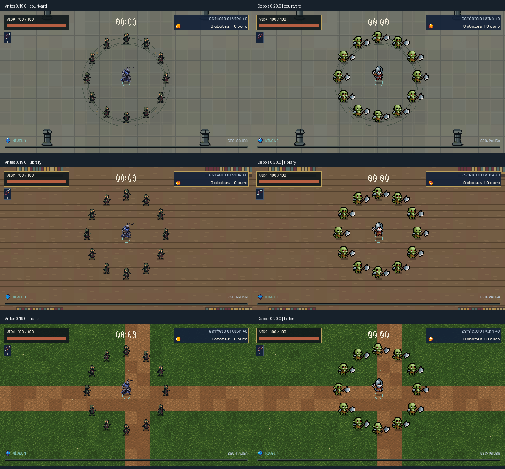

# Tiny RPG, versão 0.20.0

Escopo final escolhido: usar somente os personagens gratuitos. Soldado e Orc integrados. Necromante, esqueletos, morcego e slimes não foram substituídos e mantêm as artes anteriores. O pacote completo não foi comprado. Chefes e outros inimigos preservados.



## Arquivos e animações

Origem: [Tiny RPG Character Asset Pack 01 v2.0, Zerie](https://zerie.itch.io/tiny-rpg-character-asset-pack). Pasta local fornecida: `C:/Users/Arthur/Downloads/Tiny RPG Character Asset Pack 01 v2.0 -Free Soldier&Orc/`.

| Personagem | Animações utilizadas | Quadros |
|---|---|---|
| Soldado | Espera 6, caminhada 8, espada 6, arco 9, dano 4, morte 4 | 43 importados, incluindo 6 do segundo golpe disponíveis |
| Orc | Espera 6, caminhada 8, dois ataques de 6, dano 4, morte 4 | 34 |

O Soldado permanece sem espada fixa na espera e caminhada. A arma inicial continua Arco 1. A flecha real inicia a pose de soltura; a preparação do disparo seguinte usa o alvo já conhecido, sem adicionar busca global. Animações nunca geram outro dano ou projétil. Queda mantém o último quadro de morte. Reanimação reproduz a queda ao contrário, pois não existe uma animação própria no pacote. Espelhamento horizontal, sem fabricar direções.

O Orc substitui o zumbi visualmente, preservando o ID `ghoul`. Invocações existentes desse ID recebem o mesmo Orc. O ataque original por contato e seu bloqueio de 400 ms continuam iguais; a animação apresenta o golpe e a recuperação sem mudar o instante do dano. Apenas uma variante Orc existe no pacote gratuito. Os dois ataques disponíveis alternam por identidade. Elite conserva sua identificação e colisão anteriores, com o sprite em escala inteira.

Folhas originais: quadros 100 × 100, Soldado 900 × 700 e Orc 800 × 600. A margem transparente não define o corpo. Recorte fixo 56 × 40, ampliado exatamente 2 vezes com nearest: células 112 × 80. Pivôs na base física, sem recortar ou recentralizar cada quadro. Raios físicos preservados: jogador 7, Orc comum 8. Texturas compartilhadas entre instâncias.

As folhas completas não têm sombra embutida. Os arquivos separados têm sombra, inclusive na pasta que não a indica. Foram usadas as folhas completas para evitar duplicação da sombra do jogo.

Catálogo local: `build/tiny_rpg_catalog/index.html`, `files.json` e prévias ampliadas por animação. São 34 PNGs de origem, incluindo variantes com sombra e duas flechas. Não são 34 personagens. Fontes Aseprite e originais continuam nos Downloads.

## Integração e distribuição

`TinyCharacters` centraliza atlas, estados e intervalos dos quadros. `CharacterRemains` desenha mortes num único nó e publica somente um evento de morte pelo host. A identidade evita duplicação. Até 64 animações de corpo morto simultâneas; ao exceder, somente a animação decorativa mais antiga é descartada. Nenhum inimigo vivo, acerto ou recompensa é omitido. Animações expiram em 500 ms e são limpas no reinício. O cliente recebe quadro, orientação e pivô pelos snapshots existentes. Protocolo 2 preservado, versão de jogo 0.20.0.

Não foram modificados vida, velocidade, dano, intervalos, experiência, ouro, geração, colisão, navegação ou formato do save. A coleção atual é de itens e consumíveis, sem bestiário ou seleção de personagens separados; não foi criado um sistema adicional nesta etapa. Os testes DEV e partidas usam as entidades reais.

Os termos do autor permitem uso e modificação em jogos pessoais e comerciais e proíbem redistribuição dos assets avulsos. Atlas Tiny RPG ficam fora do GitHub e são incorporados nos executáveis. O aviso de origem acompanha a build. Para reproduzir o projeto, obtenha o pacote oficial e rode:

```powershell
python tools/tiny_rpg20.py --kind soldier --source "pasta do pacote"
python tools/tiny_rpg20.py --kind orc --source "pasta do pacote"
```

Pillow é necessário para a importação. As artes antigas do herói e do zumbi continuam no projeto para recuperação e ficam excluídas dos executáveis novos. A exportação recusa prosseguir sem os dois atlas locais.

## Execução verificada

- Soldado: 91 verificações, três mapas, espera, caminhada, ruído de controle, arco real, dano único, prioridade de dano, queda e reanimação.
- Orc: 54 verificações, três mapas, atributos e modificadores preservados, pivô, ataque real, bloqueio por atacante, dano, morte no local correto, recompensa única, evento duplicado e limpeza.
- Regressões: `adjustments18`, `content19` (223 verificações), `idle_font10`, `dev_survival13`, `dev_encounters13` (18 combinações de mapa e encontro) e `dev_attacks13` (46 ataques).
- Host e três clientes em processos separados, um renderizado: aprovados no relay local e novamente no relay público WSS usando a build DEV exportada. Execução pública: 911 verificações, incluindo réplicas, morte, build individual e restauração exata do perfil temporário.
- Ambos os executáveis nativos iniciaram e encerraram após 120 quadros no smoke headless. Harness externo também verificou os atlas incorporados, exclusão dos PNGs antigos, recompensa e reinício no pacote público.
- Público: sem recursos DEV, F8, atalhos antigos ou flags de teste.

A rodada WSS usa quatro processos no mesmo computador. Não equivale a quatro máquinas ou redes diferentes, nem a uma partida humana de trinta minutos. Tick do host no trecho inicial: mediana 7,544 ms e p95 13,519 ms; 215.061 bytes enviados até o ponto medido, não bytes por segundo.

## Carga e limites

Godot 4.7.2, janela renderizada, Compatibility/OpenGL, Ryzen 5 5600 e RX 6600. Resolução lógica 640 × 360, janela 1280 × 720. Semente 18018, quatro atores, seis armas nível 8, quatro passivas nível 8 e 200 inimigos mantidos vivos. Por mapa: 60 quadros de aquecimento e 180 amostras. [Dados brutos](benchmarks/tiny20-load.json).

| Mapa | Mediana antes/depois (ms) | p95 antes/depois (ms) | p99 antes/depois (ms) | Memória antes/depois (bytes) |
|---|---|---|---|---|
| Pátio | 61,843 / 66,946 | 77,477 / 81,940 | 80,401 / 89,406 | 67.172.511 / 68.926.988 |
| Biblioteca | 63,965 / 64,408 | 77,833 / 80,283 | 81,874 / 85,876 | 67.536.611 / 69.281.644 |
| Campos | 62,228 / 64,997 | 75,098 / 79,853 | 81,148 / 85,660 | 68.356.665 / 69.833.448 |

Havia jogos do usuário abertos e verificações headless concorrentes em parte da medição posterior. A comparação é indicativa, não isolada. O desempenho observado é insuficiente para 60 FPS e não permite atribuir toda a diferença aos sprites. Não houve redução de entidades ou mecânicas para esconder o resultado. É necessário repetir com a máquina livre para quantificar o custo visual e perfilar a carga restante. As verificações funcionais passaram; legibilidade e sensação de combate ainda dependem da avaliação humana.

Executável público: 114.565.872 bytes. DEV: 114.599.928 bytes. Público anterior: 114.588.528 bytes. O catálogo e o pacote completo não entram no executável.
