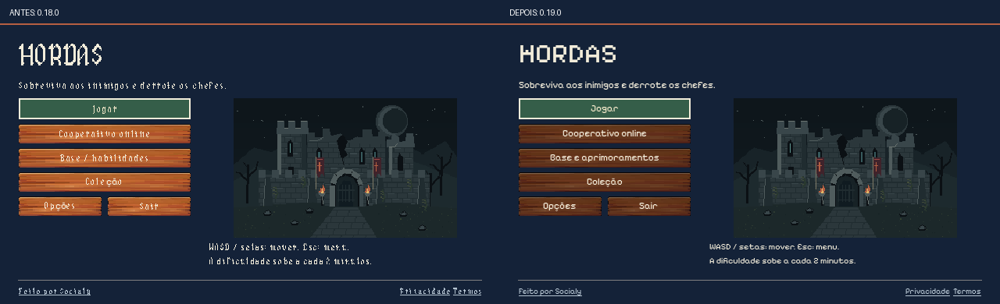
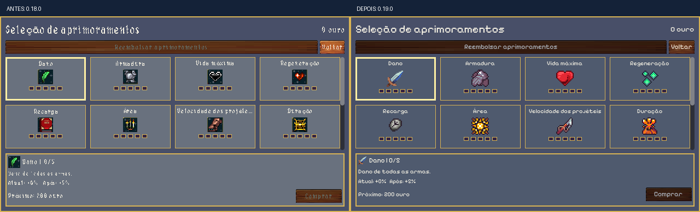
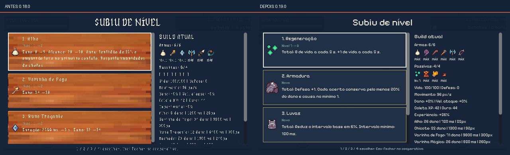
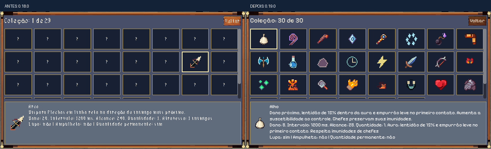

# Hordas 0.19.0

A interface usa fonte simples, ícones consistentes e painéis opacos nas descrições. Aurusenthial Gothic fica exclusivamente nos números e no separador do cronômetro da partida. Foi adicionada uma passiva de Regeneração com oito níveis. Não é uma reformulação de todos os personagens ou efeitos.

## Catálogo e seleção

O pacote fornecido contém 2.192 arquivos-base de 16×16, incluindo recolorações e variantes de material. Há 6.576 arquivos separados nas três resoluções. A comparação dos pixels visíveis confirmou que 32×32 e 64×64 são ampliações nearest das mesmas imagens. O RGB invisível de pixels transparentes difere; ele não foi contado como arte nova. As folhas completas correspondem aos arquivos separados; o IconSet RPG Maker repete a folha de 32×32.

Foram geradas e inspecionadas 12 páginas, com todos os arquivos identificados e prévias ampliadas. O catálogo integral fica localmente em `build/raven_catalog/index.html`, com índice `items.json` e verificações em `summary.json`. Não é incluído no jogo nem publicado como pacote de assets.

Famílias identificadas: armas; armaduras e acessórios; comidas e bebidas; poções; materiais, moedas e pedras; magias e elementos; atributos e estados; símbolos de interface. Muitos desenhos mágicos repetem motivos em cores diferentes, mas são ícones independentes, sem continuidade de quadros. Não foram usados como animações.

A seleção inclui **29 imagens Raven**, reunidas em um atlas de 256×128, PNG de 7.443 bytes. Base artística de 16×16, armazenada no atlas a 2× nearest. Os usos normais são 16 ou 32 pixels, preservando proporções. Não foram copiados os outros milhares de arquivos.

O catálogo central possui **54 entradas, 40 usando Raven e 14 preservadas**. IDs de saves permanecem iguais. [Lista de arquivos, IDs, nomes e telas](ASSETS_0_19.csv). O mapeamento editável está em `data/icon_catalog.json`; o gerador é `tools/raven_catalog19.py`.

Foram preservados, entre outros, Machado azul aprovado, Alho, Runa Traçante, Lança Relógio, Água Benta, Lodo, Raio, Onda de Gelo, ícones específicos de consumíveis, personagens, animação de moeda, cristal de experiência e efeitos de combate. O floco aprovado também comunica o estado de tempo parado. Um ícone foi trocado somente quando havia correspondência de função e leitura.

## Licença

Origem: [Clockwork Raven / Caio Carlos](https://clockworkraven.itch.io/raven-fantasy-icons). [Licença original v1.2](https://drive.google.com/file/d/126AltXMSr2suWyDWGpm4i7G90Zth3qtz/view), obtida pelo link da página do autor em 07/11/2026, incluída em `assets/raven/LICENSE-Clockwork-Raven-v1.2.pdf`. O aviso está em `assets/raven/NOTICE.txt`.

A versão Free é destinada a uso pessoal, definido na página como projetos gratuitos, sem microtransações ou anúncios pagos. A distribuição atual de Hordas continua gratuita. Monetização exige a licença comercial correspondente. A seleção pertence ao jogo; não autoriza redistribuir a arte como pacote independente. Não foi usado conteúdo do pacote para treinamento ou geração de arte.

O Bonescript v2 e sua licença fornecida foram inspecionados. Sua escrita desenhada não foi escolhida para textos funcionais. Foi mantida Pixelify Sans, já incluída com SIL OFL, com suporte para português e fallback para caracteres ausentes. A licença comercial da Aurusenthial confirmada pelo usuário continua sendo usada somente no cronômetro; o TTF avulso permanece fora do GitHub.

## Interface implementada

- Mesmo catálogo para melhorias, build, grade permanente, coleção, baús e seletores DEV.
- Descrições sobre azul opaco, sem textura de madeira atravessando linhas de texto. Fonte funcional maior nas opções e no painel da build.
- Botões de madeira escurecidos para melhorar o contraste do texto. Cards permanentes com contraste aumentado.
- HUD com seis armas e quatro passivas em ícones e níveis; itens máximos têm nível 8 e borda dourada. Desenho agrupado, atualizado somente quando a build muda.
- Ouro e experiência com símbolos distintos. Movimento usa perna; velocidade de projéteis usa flecha.
- Veneno, prisão, lentidão e tempo parado mostram símbolo e texto, com duração ou percentual. Não dependem apenas de cor.
- Recompensa de baú mostra o ícone do item recebido. A apresentação continua sem pausar o cooperativo.
- Comida e Relógio no chão usam escala 16×16 e sombra discreta; valores, chances, coleta e expiração permanecem iguais. A moeda continua animada.
- Coleção usa ícones de tamanho fixo centralizados, evitando ampliação fracionária pela largura das células.

## Novo conteúdo: Regeneração

Passiva da partida. Ocupa um dos quatro espaços, entra em ofertas, baús de itens já equipados, coleção e DEV. Não cura na aquisição: recupera continuamente a vida perdida, sem exceder o máximo. Soma à regeneração permanente; não regenera caídos ou mortos. O host aplica a cura e replica a vida. Clientes não autorizam a própria cura.

| Nível | Efeito da passiva | Ganho nesta escolha |
|---|---|---|
| 1 | 1 de vida a cada 5 s | Adquire a recuperação contínua |
| 2 | 2 de vida a cada 5 s | +1 de vida a cada 5 s |
| 3 | 3 de vida a cada 5 s | +1 de vida a cada 5 s |
| 4 | 4 de vida a cada 5 s | +1 de vida a cada 5 s |
| 5 | 1 de vida por segundo | +1 de vida a cada 5 s |
| 6 | 6 de vida a cada 5 s | +1 de vida a cada 5 s |
| 7 | 7 de vida a cada 5 s | +1 de vida a cada 5 s |
| 8 | 8 de vida a cada 5 s | +1 de vida a cada 5 s |

O cálculo preserva frações por atualização. Com todos os níveis da regeneração permanente e esta passiva no máximo, o total é 21 de vida a cada 10 s. Não foram alterados dano, velocidade, vida dos inimigos, ouro, experiência, preços ou cronogramas de eventos. Lâminas Orbitais continuam removidas.

## Possibilidades futuras, não implementadas

| Possibilidade | Arquivos de referência no catálogo | Função proposta | Situação |
|---|---|---|---|
| Antídoto | fa121 a fa123, poções | Remover veneno; recuperação situacional distinta de comida | Sem mecânica, chance ou imunidade adicionadas |
| Barreira | fa852 a fa859, escudos | Absorver um acerto com recarga explícita | Sem escudo novo implementado |
| Vento | fa785 e fa792, turbilhões | Abrir espaço com empurrão, sem repetir dano de uma arma existente | Somente referência; ícones não são animação |
| Variações de comida | fa481 a fa496 | Aparências coerentes para o efeito de comida já existente | Não aumentam a variedade de efeitos |
| Objetivos e recursos futuros | fa129 a fa240, moedas e materiais | Ícones para objetivos ou menus, se um sistema futuro justificar | Sem fabricação ou inventário novo |
| Aparências de equipamento | fa1809 a fa2192 | Identificação de efeitos ou futuras variações aprovadas | Sem sistema de armaduras equipáveis ou raridades |

Foi escolhida apenas uma adição inicial para não preencher a build com funções repetidas. As demais artes permanecem no catálogo local.

## Comparação visual

Antes e depois, na resolução lógica real de 640×360:

## Testes executados

- `content19`: 223 verificações, incluindo pixels do atlas contra os arquivos originais, IDs, fonte do cronômetro, fonte do HUD, oito níveis, frações de cura em 300 passos por nível, combinação com permanente, limite de vida, ausência de cura ao cair, limite de espaços, baú, reinício e rejeição de cura pelo cliente.
- `visual19`: 1.351 verificações de fonte, texto inteiro e geometria. Execução com renderização, capturas de 11 telas, grade/coleção em 480×360 e 800×450, além da escala lógica 640×360. Consumíveis, personagens, ouro, experiência e estados vistos nos três mapas; recompensa e painel DEV também capturados.
- Revisão visual detectou um atlas importado antigo e dois ícones de HUD acima da escala prevista. A importação e a ordem de configuração dos controles foram corrigidas. O teste passou a conferir também os pixels, não somente os nomes dos arquivos.
- `adjustments18`, `consumables15`, `progression8`, `permanent_effects9`, `collection15`, `dev_sandbox11`, `dev_survival13`, `dev_encounters13` e `dev_attacks13`: passaram. Incluem 18 combinações de mapa/encontro, 46 ataques, reinícios e preservação do perfil original.
- Exportações pública e DEV executaram o smoke nativo de 120 quadros e encerraram sem erro. O pacote público passou pela verificação de ausência de recursos DEV, F8 e atalhos antigos.
- `network19`: host e três clientes em processos separados, uma instância renderizada. Passou localmente e pelo WSS público do Render, usando a exportação DEV. Cura individual nos níveis 1, 2, 3 e 8, dano autoritativo, builds, restauração do save e fontes/ícones foram verificados.

As execuções renderizadas do harness usam Godot console 4.7.2 com o pacote release em `--main-pack`, para permitir o script externo de teste. Não são uma medição de FPS do executável nativo sem harness. Os smokes nativos e os testes de renderização são verificações distintas.

## Limitações

O teste WSS usa um servidor externo, mas os quatro processos estão na mesma máquina. Não comprova quatro redes ou máquinas diferentes, nem uma sessão de trinta minutos. Não foi realizado playtest humano de balanceamento da nova passiva ou de preferência estética. Os assets são estáticos; não há novas animações derivadas desses ícones. Não foi declarado que todo o design do jogo está reformulado.

As capturas completas ficam em `build/raven_catalog/after/`. O catálogo integral permanece local e separado das builds. Para regenerar: `python tools/raven_catalog19.py --integrate`, seguido de importação do projeto pelo Godot antes de testar/exportar. Editar `data/upgrades/regeneration.tres` ajusta os oito valores da nova passiva.

## Desempenho observado e tamanho

Ryzen 5 5600, Radeon RX 6600, driver 26.8.1.260806, Godot 4.7.2, GL Compatibility/OpenGL 3.3. Janela configurada em 1280×720, viewport lógico 640×360. Semente 18018, armas 18001 a 18004. Quatro atores cooperativos, seis armas nível 8 e quatro passivas nível 8 por ator, 200 inimigos, música decodificada com saída silenciada. Cada mapa usa 60 quadros de aquecimento e 180 amostras; são quatro segundos simulados por mapa.

A máquina passou a executar Valorant durante a rodada. Foi feita uma nova série antes/depois sob essa concorrência: o processo foi observado usando 476% de tempo de processador entre 12 processadores lógicos. Não fechei nem alterei o jogo do usuário. A carga externa variou, portanto estes números não isolam o custo da alteração e não demonstram ganho de FPS.

| Mapa | Mediana antes → depois, ms | p95 antes → depois, ms | p99 antes → depois, ms | Draw calls antes → depois | Memória antes → depois, MiB | Inimigos | Pico de projéteis novos |
|---|---|---|---|---|---|---|---|
| courtyard | 24.832 → 27.645 | 37.411 → 40.098 | 39.353 → 46.381 | 539 → 554 | 63.78 → 63.94 | 200 → 200 | 28 → 28 |
| library | 24.451 → 28.312 | 36.984 → 38.164 | 41.873 → 47.402 | 512 → 560 | 64.32 → 64.30 | 200 → 200 | 28 → 28 |
| fields | 24.093 → 24.870 | 35.649 → 39.715 | 41.809 → 42.645 | 539 → 564 | 64.87 → 64.80 | 200 → 200 | 28 → 28 |

Não foram reduzidos inimigos, ataques, dano ou recompensas. O HUD foi convertido de vários controles por item para comandos de desenho agrupados e retidos entre mudanças da build. Mesmo assim, a interface acrescenta desenho e os números não provam ausência de custo. Antes de a carga concorrente aparecer, a referência 0.18 apresentou medianas próximas de 17 ms; sob a concorrência, ambas as versões ficaram acima desse valor. **60 FPS estáveis não foram comprovados.** É necessário repetir uma medição mais longa com a máquina disponível para o teste.

A amostra WSS final teve 146 verificações aprovadas entre os quatro processos. O host registrou 209.978 bytes enviados até o fim do trecho inicial, com mediana de tick de 6,873 ms e p95 de 11,944 ms nesse trecho. Esse contador não é uma taxa por segundo e não representa a sessão inteira. Não houve alteração do transporte ou protocolo nesta etapa; protocolo 2, versão de jogo 0.19.0 em todos os executáveis.

| Arquivo | Bytes |
|---|---|
| Hordas-0.18.0.exe | 114,460,888 |
| Hordas-0.19.0.exe | 114,588,528 |
| Hordas-DEV-0.19.0.exe | 114,622,592 |

Aumento do público: 127,640 bytes, aproximadamente 0.11%. O pacote completo e suas páginas de catálogo não entram na build. [Amostras, configuração e hashes medidos](BENCHMARK_0_19.json).

Executáveis locais: `build/Hordas-0.19.0/Hordas-0.19.0.exe` e `build/Hordas-DEV-0.19.0/Hordas-DEV-0.19.0.exe`. F8 somente no DEV; Regeneração está na aba Jogador. Todos precisam da mesma versão para jogar online.
